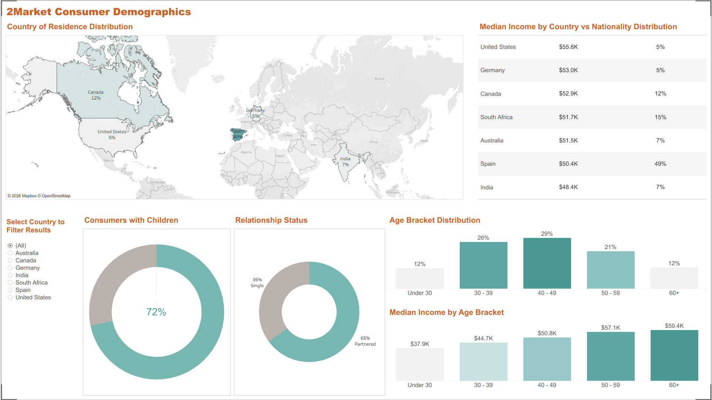
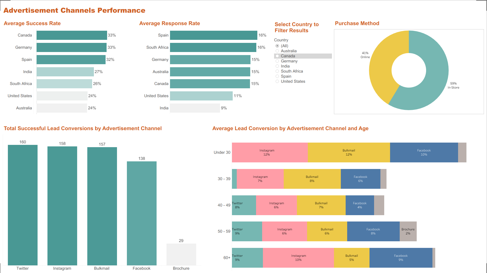
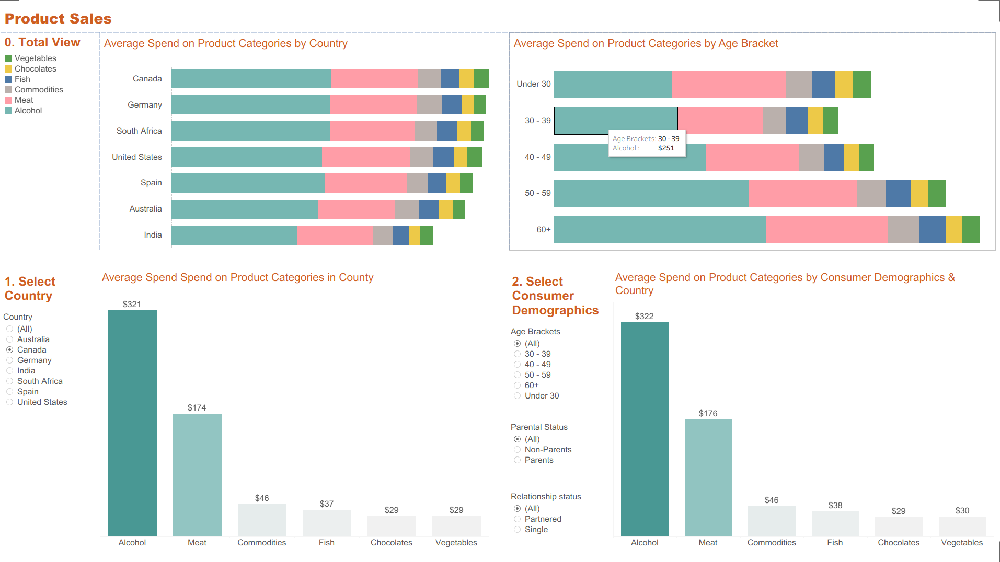

  

# 2Market-analysis-with-interactive-dashboard
Project analyzing 2Market customer data and sales performance. Key objectives are: cleaning relational datasets, building an interactive Tableau dashboard, writing SQL queries to analyze the data and deliver strategic insights to optimize marketing efficiency and drive global retail growth.

[View Interactive Dashboard on Tableau Public]( https://public.tableau.com/views/2Marketdashboard_17926732833430/ProductSales?:language=en-GB&:sid=&:redirect=auth&:display_count=n&:origin=viz_share_link )
